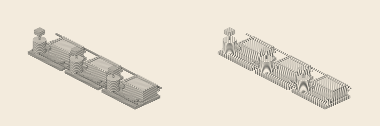

# Draw Beautiful A03-2 Spatial — mobile engraving profile

**Status:** successful experimental alternative; not yet an approved publication plate.

## Purpose and invariants

The original A03-2 open-settler geometry, fixed camera (azimuth −43°, elevation 29°, pad 72), original physical lighting, and source Draw Beautiful engine (revision `86d03dd5d722f6bd9b7dda8f0dcf308545f3fa86`) are unchanged. An opt-in `mobile-open` line profile changes only original Draw Beautiful `I.hatch` spacing (3.1 → 5.4 model SVG screen units) and `I.ink` density/line-width parameters. Default `standard` behavior remains unchanged.

## Actual 390-pixel comparison

[960 px comparison](renders/comparison-960px.png).

| Technical result | Standard | Compact |
|---|---:|---:|
| SVG bytes | 705629 | 402885 |
| Vector path layers | 154 | 148 |
| Rendered stage structure | 3 mixers, settlers and motors | identical |
| Recorded camera and physical model | unchanged | unchanged |

The reduced size is **42.9%**, measured directly from generated SVG files. The compact variant has cleaner line separation when rasterized at 390 px, with less visible aliasing/moiré in the mixer cylinders. This is a qualitative visual assessment, **not** a quantified scientific metric for moiré or a proof of mobile-device/browser fidelity.

The lighter version also loses some tonal richness at 960 px. Preserve the standard master as the large-format version; this variant is for a separately selected mobile render. No unvalidated `<picture>` swap or change to published WSB imagery has been made.

## Reproducibility and acceptance

`node --test experiments/rare-earth-cascade-a03-open/mobile-hatch.test.mjs` confirms both profiles operate on exactly the same three-stage source and camera, preserve physical SVG paths and reject invalid configurations. `node experiments/rare-earth-cascade-a03-open/build-mobile.mjs` builds both SVGs and the report. The [Actions run](https://github.com/deisign/world-system-brief/actions/runs/42201694912) completed successfully, validated original tests and SVG XML, and created previews at both 390 and 960 px.

[Original SVG](renders/a03-2-spatial-open-settler-intaglio.svg) · [Compact SVG](renders/a03-2-spatial-open-settler-mobile-intaglio.svg) · [Run report](renders/mobile-hatch-report.json).

**Decision:** keep both profiles as candidate assets. Submit for final editorial selection of mobile variant. The artwork remains experimental until pipeline metadata for `generic_processing_cascade`, technical source review and manual publication approval are complete.
