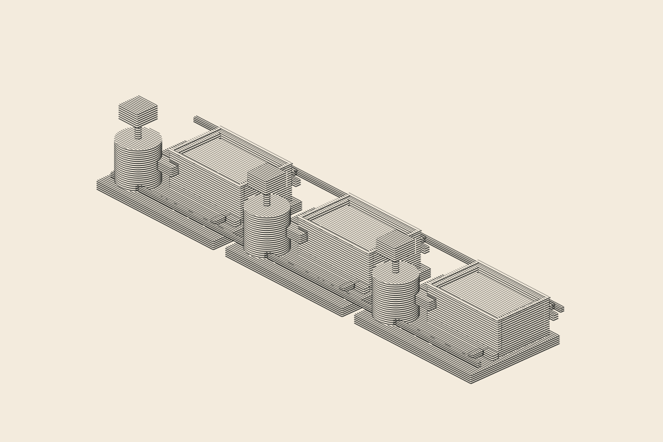

# A03-2 Spatial Open Settler — candidate review, 6 November 2026

**Current decision: selected physical composition; NOT YET an approved WSB plate.**

## Scope, provenance and authenticity

- Artwork source: exact physical geometry and procedural line renderer in [A06 scene](../rare-earth-cascade-a06/scene.mjs); only the opt-in `openSettler=true` feature is used.
- Renderer: original vendored [Draw Beautiful intaglio](../rare-earth-cascade-a06/vendor/intaglio.mjs), pinned at commit `86d03dd5d722f6bd9b7dda8f0dcf308545f3fa86` (MIT).
- **Fixed:** 3 modules; camera `azimuth=-43, elevation=29, pad=72`; light `I.direction(-128,53)`; 960×640 plate.
- [Bilingual editorial passport](plate-passport.json), including description, mechanism, limitations and accessible alternative text. No claim of reconstructing a named factory.

## Actual technical checks

`plate_qa.py` runs original Node build and compares the vector SHA256 across two separate executions, then validates XML and visible path classification for mixers, motors, settlers, rims and internal surfaces in all three stages. It also rasterizes directly from the SVG at 390/960/1920 px, confirms ink coverage and verifies margins. No image-generation model, SVG-embedded bitmap or paint-on-style imitation is involved.

[Machine-generated QA report](renders/plate-qa.json) holds the actual hashes, 6 viewport bboxes and path counts. The vector comprises **154 physical SVG path layers** in intaglio mode; mass pass 157.

### True SVG / actual pixel proofs

| Width | Actual rendered output |
|---|---|
| Mobile 390 px |  |
| Plate 960 px |  |
| Large 1920 px | [Full-resolution proof](renders/a03-2-spatial-open-settler-intaglio-1920px.png) |

[Vector master](renders/a03-2-spatial-open-settler-intaglio.svg) · [Actual mass study](renders/a03-2-spatial-open-settler-mass.svg).

## Qualitative editorial judgement

**Pass:** a strong oblique rhythm of three stages; drive/mixer cylinder versus long gravity-settler basin remains identifiable at plate size; open rims and recessed horizontal planes are visibly different from old closed boxes; substantial paper space remains. The user selected this A03-2 Spatial framing, so treat it as the composition baseline.

**Unresolved:** at 390 px the fine horizontal hatch marks partly collapse into visually distracting moiré; successful file/ink-coverage assertions do **not** prove print or phone legibility. The source geometry still depicts schematic phase-routing bars, not a source-verified industrial P&ID. The basin appears fairly shallow: do not imply verified process vessel depth or calibrated liquid interfaces. No measured chemistry, processing capacity or China market-share information can be inferred from this plate.

## Next quality gate

1. Review 390 px ink rendering side by side with large SVG in an actual browser; assess whether the engraving should appear at full-width zoom rather than as a tiny inline illustration. 
2. If needed, tune **geometry-dependent hatch density only as an explicitly versioned plate profile** while holding the approved camera and vessels stable. Do not fake more texture with raster AI.
3. Technical review of the two conceptual transfer manifolds before attaching a process topology diagram.
4. Only after manual plate acceptance: extend the production editorial validator to accept `generic_processing_cascade`, add bilingual related-study link and register it with an evidence-backed analysis. The experimental work does **not** change the published WSB manifest.

**Editorial status now:** `technical_qa_passed__editorial_review_pending`; artwork **not** deployed.
