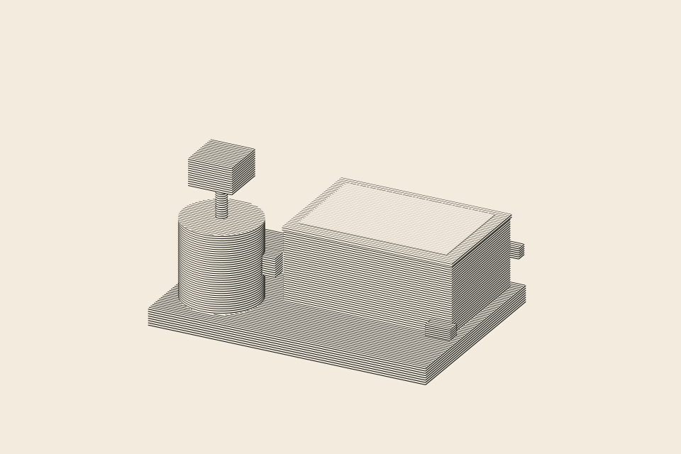
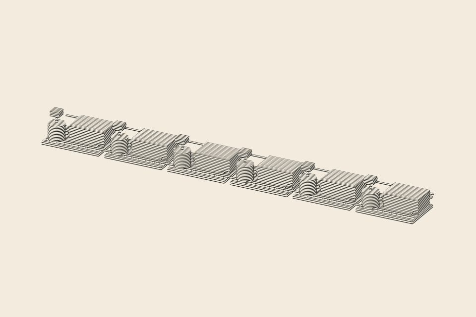
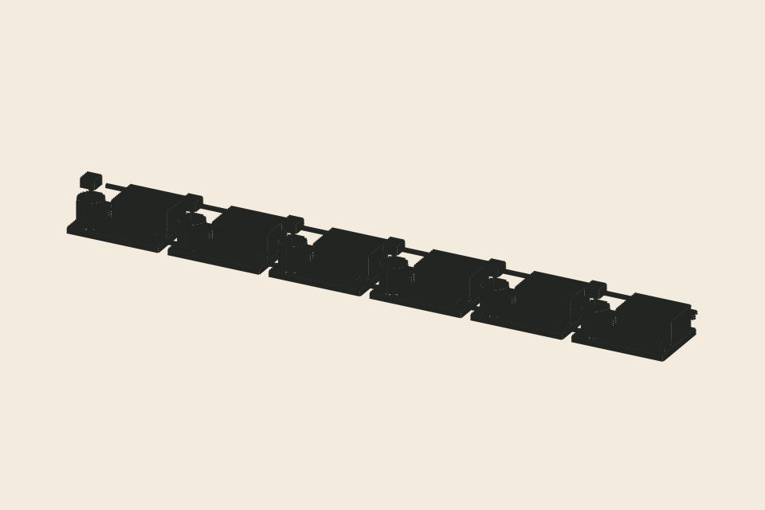

# Cascade A06 — genuine Draw Beautiful geometric engraving experiment

**Status: EXPERIMENT / NOT APPROVED FOR PUBLICATION**

## Execution

The physical model is in [scene.mjs](scene.mjs), the deterministic build is in [build.mjs](build.mjs), and the regression tests are in [scene.test.mjs](scene.test.mjs). The original `kit/intaglio.mjs` is vendored unchanged in [vendor/intaglio.mjs](vendor/intaglio.mjs), pinned to upstream `bumicodes/draw-beautiful` at `86d03dd5d722f6bd9b7dda8f0dcf308545f3fa86`, with the original MIT [license](vendor/LICENSE). No raster or diffusion-model image is used as engraving source.

The workflow [Draw Beautiful A06 experiment](../../.github/workflows/draw-beautiful-a06.yml) executes `node --test` and `node build.mjs`, verifies true SVG paths, archives exact SVG + inspection PNG, and commits outputs to the experiment branch only.

## Actual previews

| One physical stage (intaglio) | Six physical stages (intaglio) |
|---|---|
|  |  |

- [One-stage SVG](renders/stage-a-01-intaglio.svg)
- [Six-stage SVG](renders/cascade-a-06-intaglio.svg)
- [Six-stage mass SVG](renders/cascade-a-06-mass.svg)
- [Machine-generated execution report](renders/report.json)

## Editorial visual inspection, 6 November 2026

**Single stage:** cylindrical mixer, drive and rectangular settler are distinguishable; the mixer/settler scale contrast survives true procedural line rendering. This is **not** proof of process chemistry or real equipment size.

**Six stages:** the repeating forms merge into a long, low industrial strip. The eyes register repetitive boxes rather than a sequence of distinct physical functions; at reduced/mobile size the mixer/settler distinction becomes hard to read. The mass test confirms the same problem even before fine tonal effects. There is substantial empty space relative to the actual object.

**Decision: REJECT six-stage A06 as the final editorial composition.** Keep the geometry and original render as research; do not add this image to `visualizations/engravings/manifest.json`, mark it `reviewed`, or connect it to an issued WSB publication.

## Next targeted experiment

Instead of attempting to “save” A06 with denser etching, make a **two- or three-stage close study** with a technically honest countercurrent flow sketch alongside it. The plate should privilege the physical distinction between a driven small mixer and an extended gravity settler; the separate diagram, not the engraving, should communicate opposing aqueous/organic streams. Test at 390 px and 960 px before proceeding. Avoid a fake waterfall, manufactured tanks and unverified engineering dimensions.

**Limitation:** The two interstage manifold bars in A06 are visual route placeholders; they are not a validated engineering P&ID or proof that the depicted branch arrangement is technically executable.
